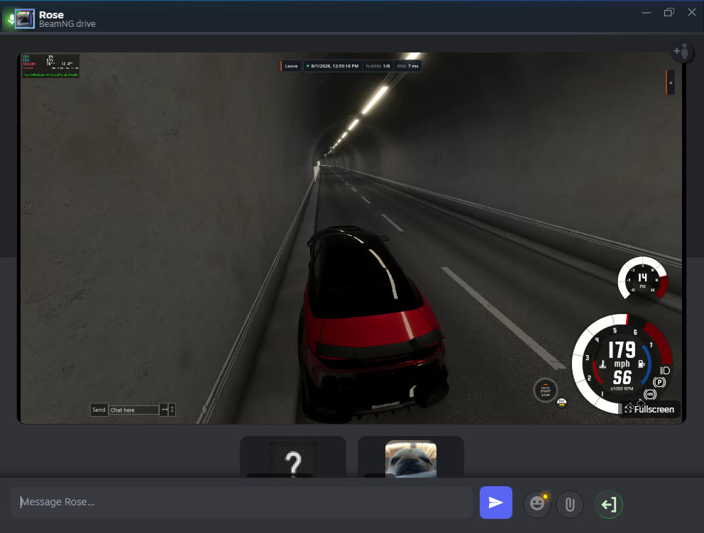
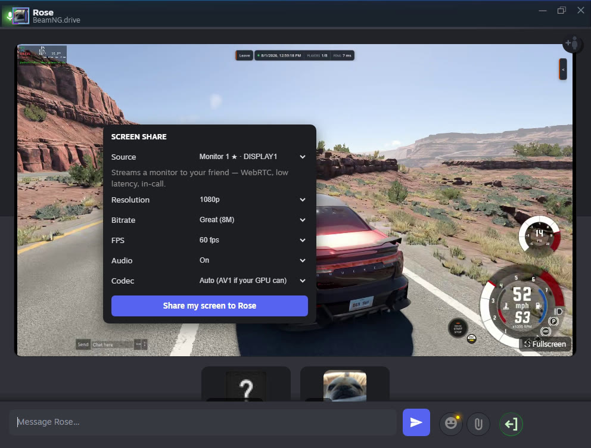

# discord-ish-steam

A [Millennium](https://steambrew.app/) plugin that makes Steam's friends & chat window
look and work more like Discord, and adds **screen sharing inside Steam voice calls**.
Steam's own chat, calls and voice keep doing the real work; this restyles the UI and adds
what Steam is missing. Linux (X11 + Wayland) and Windows.

Built with help from an LLM (Claude). Bug reports and PRs welcome.



## Features

- **Discord-style layout**: chats docked into the friends list (turned on for you), one
  merged friends list with group chats pinned on top, a clean composer, voice controls in
  the chat header.
- **Call screen**: participant tiles with speaking rings and mute badges, a proper
  incoming/outgoing call card, minimize-to-corner.
- **Screen sharing** in the call: a monitor, a single app window, or a webcam, with desktop
  audio. Peer-to-peer, encrypted, adjustable quality (up to 4K60, AV1 or H.264).
- **Mic noise cancellation** (RNNoise), no virtual audio device needed. On by default.



## Install

### Windows

**[Download discord-ish-steam-setup.exe](https://github.com/Reedo22/discord-ish-steam/releases/latest/download/discord-ish-steam-setup.exe)**,
run it, and click **Yes** on the admin prompt. It installs Millennium if you don't have it,
plus ffmpeg, git, the plugin and the share helper, then restarts Steam. Run it again any
time to update. Nothing Python-related is installed system-wide (the helper has its own
private runtime).

> The EXE isn't code-signed, so Windows may say "Windows protected your PC": click
> **More info → Run anyway**. It's built from this repo by GitHub Actions, which also
> installs it on a fresh Windows machine on every change.

Prefer a terminal? From an **Administrator** PowerShell:
```powershell
irm https://raw.githubusercontent.com/Reedo22/discord-ish-steam/master/install.ps1 | iex
```
Every run is logged to `%TEMP%\discord-ish-steam-install.log`.

### Linux

Install [Millennium](https://steambrew.app/) and start Steam once, then:
```bash
git clone https://github.com/Reedo22/discord-ish-steam ~/discord-ish-steam
cd ~/discord-ish-steam && ./install.sh
```
`install.sh` installs the dependencies (apt/dnf/pacman), links the plugin, enables it,
writes the theme, and sets up the share helper as a systemd user service. Then fully
restart Steam (`steam -shutdown`, relaunch).

### Updating

The plugin updates itself: on every Steam start it loads the newest version from this
repo (falling back to the installed copy when offline). The share helper updates when
you re-run the installer (Windows) or `./update.sh` (Linux).

## Screen sharing

In a call, click the **screen** button, pick a source and quality, and press **Share**.
Your friend sees it as a tile in the call; click it to enlarge, then **Fullscreen**.

- **Sources**: any monitor, an app window, or a webcam. On Wayland, "App window" opens the
  desktop's own picker; the first monitor share asks once and is remembered after that.
- **Quality**: 1440p60 at 8 Mbps by default. AV1 when your GPU can encode it (RTX 40,
  RX 7000, Intel Arc), else H.264. AV1 needs roughly half the bitrate for the same
  quality, and every viewer can play it.
- **Audio**: your desktop audio, *except Steam itself*, so the call's voices don't echo back
  to your friend (and two people sharing at once don't feed back into each other).
  Add more apps to leave out with `DS_AUDIO_EXCLUDE=vesktop,...`.

### How it connects, and privacy

- **Peer-to-peer WebRTC**, encrypted with **DTLS-SRTP** like any browser video call. The
  helper opens **UDP 8189** on your router with UPnP so your friend connects straight to
  you; your friend doesn't need to open anything.
- **Connection setup** goes over HTTPS, and the share link is sent to your friend as a
  hidden Steam chat message. Every share gets a new random access key; nothing answers
  without it, and old links die when you stop.
- **If a direct connection isn't possible** (UPnP off, carrier-grade NAT), the stream falls
  back to a WebSocket over HTTPS through a Cloudflare quick tunnel, or through your own
  domain if you set one up (below). That path is not peer-to-peer: TLS ends at Cloudflare
  or your proxy. Forwarding UDP 8189 manually restores the direct path.
- **Your IP**: like hosting a game, the friend you share with can see your public IP
  (Steam's own voice chat hides it behind Valve's relays). Nobody else gets it.
- On your own LAN the fallback paths use plain HTTP/WebSocket.

**Own domain (optional):** point an HTTPS reverse proxy at port 48890 (path `/screen/`,
WebSocket upgrade, buffering off) and put `{"url": "https://your.domain"}` in
`~/.config/discordish/public.json` (or set `DS_PUBLIC_URL`). No tunnel is used then.

### Under the hood

A small helper (`rp-webrtc.py`, localhost only) does the capture that Steam's browser
sandbox can't:

```
capture ─▶ hardware encode (AV1/H.264 + Opus) ─▶ MediaMTX ─▶ WebRTC ───────┐
  Windows: gdigrab                                                          ├─▶ viewer
  Linux X11: x11grab / ximagesrc                                            │
  Linux Wayland: ScreenCast portal ─▶ PipeWire                              │
                                    └─▶ fragmented MP4 over WebSocket ──────┘
```

One capture and one encode feed both transports; the viewer races them and keeps
whichever connects first. Desktop audio is captured without a virtual device: a private
PipeWire stream on Linux, WASAPI process loopback on Windows 10 2004+/11.

## Troubleshooting

- **Diagnose the helper**: `python3 rp-webrtc.py --selftest` (Linux) checks capture,
  encode and audio. Logs: `journalctl --user -u discordish-rp-webrtc` (Linux),
  `%TEMP%\rp-webrtc.log` (Windows).
- **"Screen-share helper isn't running"**: Linux `systemctl --user restart
  discordish-rp-webrtc`; Windows: re-run the installer.
- **Plugin not loading at all**: update Millennium. Old builds can fail to start plugins on
  current Steam (the Windows installer updates it for you).
- A minimized window can't be shared (it isn't drawn); behind other windows is fine.

## Development

- `theme/friends.custom.css`: the reskin (loaded through Millennium's quick CSS).
- `plugin/.millennium/Dist/index.js`: the plugin, hand-written, no build step (CRLF line
  endings). Bump `VERSION` so installed copies pick it up.
- `rp-webrtc.py`: the share helper. Its control API on `127.0.0.1:48592` only answers
  Steam's own pages and non-browser clients, so a website can't start a share.
- `install.ps1` / `bin/installer.nsi`: Windows installer and setup EXE. Pushing a `v*` tag
  publishes the EXE as a release.
- Tests: `tests/run.sh` (Python stdlib + Node ≥ 18). CI runs them on Linux and Windows and
  installs the setup EXE on a fresh Windows runner.

The plugin deliberately has **no Millennium backend**: Millennium holds Steam's window until
every plugin backend reports ready, and some builds hang there, so the helper is started by
systemd / a Windows logon task instead.
